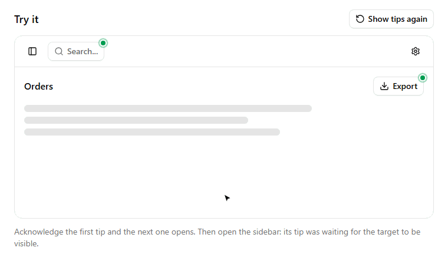

# Beacon Tip

A [shadcn/ui](https://ui.shadcn.com) component that puts a pulsing beacon on any element and opens a small
"what's new" or tip popover next to it. No tours and no modals: one tip at a time, in the place where the feature lives.

**[Live demo](https://tautorn.github.io/beacon-tip/)**



- **One at a time.** Only the first unseen tip opens on its own. The others keep pulsing until it is their turn.
- **Hidden targets wait.** A tip inside a collapsed sidebar or an inactive tab joins the queue when it becomes visible.
- **Announcements expire.** Give a tip an `until` date and it stops showing after that day.
- **Typed ids.** Tips come from one catalog, so a typo in an id is a compile error.
- **Snooze or acknowledge.** Closing the popover hides it for this visit. "Got it" remembers it. "Skip all" clears the queue.
- **Bring your storage.** Seen tips go to `localStorage` by default, or to your server with two functions.

## Install

```bash
npx shadcn@latest add https://tautorn.github.io/beacon-tip/r/beacon-tip.json
```

This adds `components/beacon-tip.tsx` and, if missing, the `popover` and `button` components and `lucide-react`.
The beacon and badge use your theme's `primary` color.

## Usage

Create the catalog once:

```tsx
// lib/tips.ts
import { createBeaconTips } from '@/components/beacon-tip'

export const { BeaconTip, useBeaconTips } = createBeaconTips({
  'command-menu': {
    kind: 'new',
    title: 'Command menu',
    body: 'Press Ctrl K anywhere to jump to a page.',
    until: '2026-12-31',
  },
  'export-csv': {
    kind: 'tip',
    title: 'Export',
    body: 'Download the current view as a spreadsheet.',
  },
})
```

Wrap the element the tip points at:

```tsx
import { BeaconTip } from '@/lib/tips'

<BeaconTip id="command-menu" side="bottom">
  <Button variant="outline">Search</Button>
</BeaconTip>
```

Once a tip is seen or expired, `<BeaconTip>` renders only its children.

### Tip definition

| Field | Type | |
|---|---|---|
| `title` | `string` | |
| `body` | `ReactNode` | |
| `kind` | `'new' \| 'tip'` | Badge and icon. Defaults to `'tip'`. |
| `until` | `string` | Last day shown, `YYYY-MM-DD` in local time. |
| `priority` | `number` | Higher opens first. Ties keep the order the targets appeared in. |

The id is what gets stored as seen. Renaming an id shows that tip to everyone again.

### `<BeaconTip>` props

| Prop | Type | Default |
|---|---|---|
| `id` | catalog key | |
| `side` | `'top' \| 'right' \| 'bottom' \| 'left'` | `'right'` |
| `align` | `'start' \| 'center' \| 'end'` | `'start'` |
| `className` | `string` | Wrapper class, e.g. `w-full` for a full-width target. |

### Options

```tsx
createBeaconTips(tips, {
  openDelay: 700,
  labels: {
    new: 'Novidade',
    tip: 'Dica',
    acknowledge: 'Entendi',
    skipAll: count => `Pular todas (${count})`,
  },
  storage: localStorageAdapter('my-app:seen-tips'),
})
```

To keep seen tips on your server, pass any `load` and `save`. Both may be async; tips stay hidden until `load` resolves.

```tsx
storage: {
  load: () => fetch('/api/seen-tips').then(r => r.json()),
  save: seen => fetch('/api/seen-tips', { method: 'PUT', body: JSON.stringify(seen) }),
}
```

### `useBeaconTips()`

```tsx
const { ready, isSeen, markSeen, reset } = useBeaconTips()
```

`reset()` shows every tip in the catalog again. It is handy behind a "Show tips again" menu item.

## Development

```bash
npm install
npm run dev              # demo at localhost:5173/beacon-tip/
npm run registry:build   # writes public/r/beacon-tip.json
```

The component lives in `registry/new-york/beacon-tip/beacon-tip.tsx`. Pushing to `main` deploys the demo and the
registry to GitHub Pages.

## License

MIT
